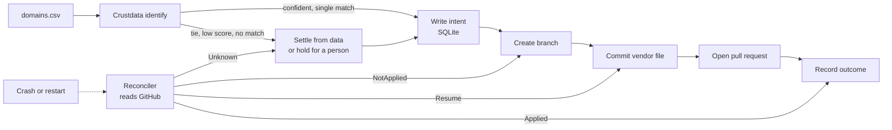

<div align="center">


# Identa

**Vendor onboarding that checks before it retries.**

Identa adds vendors to a company's register, one GitHub pull request each, and never adds the same vendor twice, even after a crash or when several copies run at once.

[](LICENSE)
[](pyproject.toml)
[](pyproject.toml)
[](pyproject.toml)

[Live results](https://identa-iota.vercel.app) · [The register it writes to](https://github.com/Datwebguy/identavendors)

</div>

---

## Contents

- [Overview](#overview)
- [The problem](#the-problem)
- [How it works](#how-it-works)
- [Results](#results)
- [Quick start](#quick-start)
- [Usage](#usage)
- [Configuration](#configuration)
- [Design decisions](#design-decisions)
- [Project layout](#project-layout)
- [Development](#development)
- [Deployment](#deployment)
- [Limitations and roadmap](#limitations-and-roadmap)
- [Security](#security)
- [License](#license)

## Overview

You give Identa a list of company domains. For each one it:

1. **Identifies** the real company through Crustdata, with a confidence score.
2. **Writes its intent down** in a local SQLite store before it touches anything.
3. **Acts** on GitHub in three steps: create a branch, add a vendor file, open a pull request.
4. **Checks GitHub before acting again** if anything was interrupted, and finishes only what is missing.

Companies it cannot identify with confidence are held for a person. Identa never guesses.

Highlights:

- **Safe to stop, restart and run twice.** Every action has a stable name, so the same job always lands on the same branch.
- **Reads the real world, not its own memory.** After a crash it asks GitHub what actually happened.
- **Explains its decisions.** Each match, hold and recovery is saved with its reason.
- **Remembers what a person decides.** A rejected company is not sent back for review next time.
- **No model calls.** Every decision is deterministic code, so runs cost no tokens and give the same answer twice.
- **Evidence by default.** Every Crustdata and GitHub response is saved with a timestamp under `evidence/`, and the results page is built from those files and nothing else.

## The problem

An agent that acts on an outside system and then crashes does not know whether the last action happened. If it retries, the action can happen twice. For vendor onboarding, a duplicate means two payables, two contracts and two approval chains for one company.

GitHub's REST API gives no idempotency key for creating a pull request or a git reference, and no documented error for a duplicate pull request, so a retry cannot rely on GitHub to refuse it. Identa solves this with a stable job name and a check against the real state before every retry.

## How it works



### Stable names

| Thing | Rule |
|---|---|
| Company identity | The Crustdata company ID |
| Idempotency key | `sha256(company_id, action, canonical_json(args))` |
| Branch | `<prefix>/<company_id>-<first 8 hex of the key>` |
| File | `vendors/<company_id>.yaml` |

The same company and the same intent always produce the same names, so the reconciler can look an action up by exact name.

### The reconciler

After any interruption, Identa reads the branch, the file and the pull request on GitHub and returns one of four verdicts:

| Verdict | What it saw on GitHub | What Identa does |
|---|---|---|
| **Applied** | Branch, file and pull request all exist and match | Records the outcome. Writes nothing. |
| **NotApplied** | The branch does not exist | Safe to act again from the start |
| **Resume** | The branch exists but the file or the pull request is missing | Continues from the missing step only |
| **Unknown** | A check failed, or the content does not match the intent | Holds the company for a person |

The decision is a pure function (`verdict.decide`) of GitHub's answers, so it is unit tested without any network.

### Choosing between similar companies

A company is accepted only when its top Crustdata match scores at or above the configured threshold (0.9). When two matches share the top score, Identa settles the tie from the matches themselves: it picks the only match whose primary domain is the requested domain, or else the only one whose website is exactly that domain, and records why. A tie that nothing separates, a low score or no match is held for a person.

### Memory

A person's accept or reject, with a reason, is stored. Before holding a company, Identa recalls it: a company rejected earlier is not queued again, and an earlier choice among tied matches is applied without a new review. Open queue entries for a domain that is later settled are closed.

### Observability

Runs are traced with [neatlogs](https://neatlogs.com): a workflow span per run and a tool span for each Crustdata and GitHub call. Request inputs are never captured on tool spans, so keys cannot reach a trace.

## Results

Every number below comes from a saved run under [`evidence/`](evidence/) and was read from GitHub after the run, not from the agent's own report. The same numbers are shown, with links to the files behind them, on the [results page](https://identa-iota.vercel.app).

| Test | With Identa | Without the check |
|---|---|---|
| Process stopped once at each of three points, 9 companies each | 0 duplicate pull requests, 0 duplicate branches | 1 duplicate pull request, 3 duplicate branches |
| 8 copies started at the same moment on one company | 1 branch, 1 pull request (GitHub refused 7 of 8 branch requests) | 8 branches, 8 pull requests, 7 duplicates |
| Time from the stop to a finished reconciliation | 2.17 s, 2.42 s, 2.59 s | not applicable |
| Re-run and crash recovery, Crustdata credits | 0 | 0 |

More measured facts:

- First full run: 9 of 9 companies onboarded as pull requests #1 to #9, in 34.92 s (3.88 s per company).
- Crustdata cost: 2 credits per new company (18 credits for 9) at $0.30 per credit, so $0.60 per company. Identify is free.
- Two of the nine domains had two equally good Crustdata matches (`cfo.ai`, `amazon.com`). They were first held for a person, which produced the first `Unknown` verdict. The tie-breaker added afterwards settles both from the same saved answers.

**How the comparison is built.** The "without the check" version is the same executor with the reconciler removed and a blind retry on any error. It has no memory across runs and no stable key, so every attempt names its own branch. It is run at the same crash points so duplicates can be counted. `measure` then counts branches and pull requests per company directly from GitHub.

## Quick start

### Requirements

- Python 3.11 to 3.13
- A [Crustdata](https://crustdata.com) API key
- A GitHub fine-grained token with contents and pull request access to **one** repository (the register)
- A [neatlogs](https://neatlogs.com) API key

### Install

```bash
git clone https://github.com/Datwebguy/identa.git
cd identa
python -m venv .venv && source .venv/bin/activate
pip install -e '.[dev]'
```

### Set your keys

Keys are read from environment variables only and are never written to the repository.

```bash
export CRUSTDATA_API_KEY=...
export GITHUB_TOKEN=...
export NEATLOGS_API_KEY=...
```

### Configure the register

Edit `identa.toml` so it points at your own register repository:

```toml
confidence_threshold = 0.9
repo_owner = "your-github-user"
repo_name = "your-register-repo"
base_branch = "main"
store_path = "data/identa.sqlite"
evidence_dir = "evidence"
commit_author_name = "Your Name"
commit_author_email = "you@example.com"
branch_prefix = "vendor"
```

### Run

Put one company domain per row in `domains.csv` (a `domain` header row is skipped), then:

```bash
python -m identa run --config identa.toml --domains domains.csv
```

Run it again, or stop it halfway and run it again: nothing is added twice.

## Usage

| Command | What it does |
|---|---|
| `run --config C --domains D` | Onboards the domains, reconciling any unfinished work first |
| `run --control --max-attempts N --config C --domains D` | Runs the comparison version (blind retry, no reconciler) |
| `race --domain DOMAIN --agents N [--control] --config C` | Starts N independent copies on one company at the same moment |
| `measure [--prefix P] --config C` | Counts branches and pull requests per company on GitHub and saves the count |
| `queue list --config C` | Lists the companies held for a person |
| `queue accept ID [--company-id ID] [--reason TEXT] --config C` | Accepts a held company, optionally choosing one of the tied matches |
| `queue reject ID [--reason TEXT] --config C` | Rejects a held company and remembers why |
| `export-evidence --since STAMP --config C` | Copies evidence files to the register's `evidence` branch (for containers) |

To test crash recovery, set `IDENTA_CRASH_AFTER` to `create_branch`, `commit_file` or `open_pr`. The process exits once at that step (exit code 137) and writes a marker file beside the store, so a restart recovers instead of crashing again. The next run reconciles before doing new work.

## Configuration

| Key | Meaning |
|---|---|
| `confidence_threshold` | Minimum Crustdata confidence to accept a match (0.9) |
| `repo_owner`, `repo_name` | The register repository |
| `base_branch` | Branch the pull requests target |
| `store_path` | SQLite file holding intents, steps, outcomes, the human queue and decisions |
| `evidence_dir` | Where timestamped API responses are saved |
| `commit_author_name`, `commit_author_email` | Author and committer of the vendor files |
| `branch_prefix` | Namespace for branches (also set with `IDENTA_BRANCH_PREFIX` for a test run) |

Every key is required. There are no defaults, so no value is silently invented.

| Environment variable | Used for |
|---|---|
| `CRUSTDATA_API_KEY` | Identify and enrich |
| `GITHUB_TOKEN` | Branches, files and pull requests in the register |
| `NEATLOGS_API_KEY` | Tracing |
| `IDENTA_BRANCH_PREFIX` | Overrides `branch_prefix` for a test run |
| `IDENTA_CRASH_AFTER` | Injects a one-time crash after a named step |

## Design decisions

- **Write intent before acting.** The intent is on disk before the first GitHub call, so a crash always leaves something to reconcile.
- **Never retry an external write from the model or the executor.** Retrying is the workflow layer's job, and only after the reconciler has read GitHub.
- **Unknown always goes to a person.** The agent never guesses which way an ambiguous state resolves.
- **GitHub file writes run one at a time.** GitHub documents that concurrent file writes conflict.
- **Evidence is saved, not summarised.** Raw responses are stored with a timestamp and never include request headers, so no key can land in them.
- **Deterministic by design.** No language model is called, so behaviour is reproducible and cheap.

## Project layout

```
src/identa/
  keys.py          stable identity: idempotency key, branch and file names
  verdict.py       pure function mapping GitHub's answers to a verdict
  reconciler.py    reads the branch, file and pull request from GitHub
  executor.py      runs the GitHub steps for one intent, never retries
  workflow.py      decide, intend, act, recover; tie-breaking and memory
  store.py         SQLite: intents, steps, outcomes, human queue, decisions
  crustdata.py     identify and enrich, rate limits, credit balance
  github.py        GitHub REST calls (writes are serialised)
  control.py       the comparison version without the reconciler
  race.py          several independent copies at the same moment
  measure.py       counts branches and pull requests per company
  evidence.py      timestamped API responses
  tracing.py       typed neatlogs wrappers
  __main__.py      command line
tests/             unit tests for the pure logic and the store
scripts/           build_site.py (results page from evidence), container entry point
web/               the static results page
api/identify.js    read-only company check used by the results page
evidence/          saved API responses from the real runs
```

## Development

```bash
ruff check . && ruff format --check .
mypy src tests scripts/build_site.py
pytest
node --test tests/identify.test.js
```

Tests use small literal inputs for the pure logic only (keys, verdicts, tie-breaking, memory, the store). The behaviour against real systems is covered by the saved runs under `evidence/`, not by mocks.

Rebuild the results page after new evidence is saved:

```bash
python scripts/build_site.py
```

## Deployment

- **Agent:** a container (`Dockerfile`, `railway.json`, `scripts/railway_entry.sh`) with a volume at `/data` for the store and evidence. The command it runs comes from the `IDENTA_ARGS` variable, and keys are platform variables.
- **Results page:** the static files in `web/`, served by Vercel (`vercel.json`). The small function in `api/identify.js` looks one domain up in Crustdata for the read-only company check and writes nothing.
- **Rollback:** the host keeps every deployment, so a previous one can be promoted from its dashboard. `main` only moves forward; a change is undone with a new commit.

## Limitations and roadmap

Stated plainly:

- The review queue is a command line, not a web page.
- In the race test, 7 of 8 copies stop without finishing because GitHub refuses their writes. Each copy's memory lives inside its own process, so nothing resumes them later.
- The company check on the results page has a per-address limit in its code, but each request can run on a different server instance, so the limit is not enforced. The lookup is free but shares Crustdata's identify rate limit with the agent.
- No scheduler: runs start when you start them.
- Learned rules from repeated cases are not built.

## Security

- Keys come from environment variables and are never committed, logged or written into traces or evidence.
- The GitHub token should be fine-grained and limited to the register repository.
- `.env` files are git-ignored.
- To report a vulnerability, contact the maintainer through GitHub.

## License

MIT. See [LICENSE](LICENSE).
